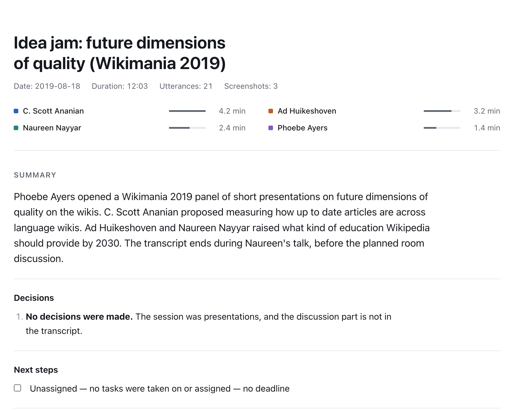
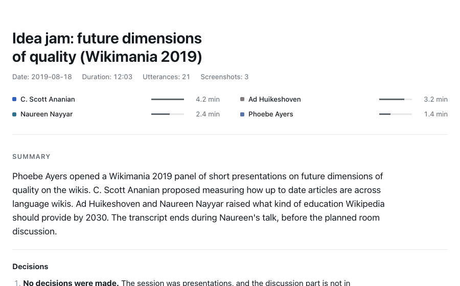
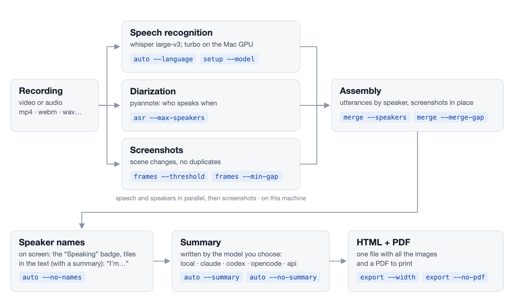

**English** | [Русский](README.ru.md)

# meeting-transcribe

[](LICENSE)


A transcript of a meeting recording, by speaker, with screenshots of the shared screen. Recognition and
speaker separation run on your machine: the recording never leaves it. The summary is written by a local model
or a large LLM of your choice: Claude, Codex, any model of your OpenCode or through an API. You get `transcript.md`, a plain
text file with timestamps, one HTML file with the images embedded that is easy to drop into a chat, and a PDF.

## Install

```bash
git clone https://github.com/Begemot34/meeting-transcribe.git && cd meeting-transcribe && ./transcribe setup
```

Or ask an agent (Claude Code, Codex, OpenCode, Gemini CLI, Cursor):

```text
Install meeting-transcribe following https://github.com/Begemot34/meeting-transcribe/blob/main/INSTALL.md — only the steps from there.
```

[INSTALL.md](INSTALL.md) is a short guide for the agent: what to check, what to ask you (languages and what
writes the summary) and the install command. You can read it yourself before pasting.

## Usage

```bash
./transcribe auto meeting.mp4 out/grooming --summary local
```

The result is in `out/grooming`: `grooming.html` (one file with all the images), `grooming.pdf` and
`transcript.md`. `local` is the model that writes the summary, on this machine. It can also be `claude`,
`codex`, `opencode` or `api`.

To fix or add names by hand, write them to `names.json` (what `auto` found is in
`out/grooming/.work/names.json`): `{"SPEAKER_00": "Anna", "SPEAKER_01": "Oleg"}`, rebuild the transcript and
make the summary again, now with the names:

```bash
./transcribe merge out/grooming/.work out/grooming --speakers names.json --title grooming --date 2026-11-03
./transcribe summarize out/grooming --llm local    # or export if you need no summary
```

An agent does more: it looks at the frames itself, so it also names the person sharing the screen and those
who appear only in the text, picks the screenshots and fixes disputed utterances. Once:

```bash
./transcribe install-skill    # puts SKILL.md into ~/.claude/skills, ~/.agents/skills and ~/.cline/skills
```

Then ask Claude Code, Codex, OpenCode, Gemini CLI, Cursor or Cline: "make a transcript of
~/Downloads/meeting.mp4 with a summary". The agent follows [SKILL.md](SKILL.md): it reviews the frames, reads
names from the "who is speaking" badge, the video tiles or the way people introduce themselves, and labels the
utterances with names instead of `SPEAKER_00`. To call the skill by name: `/meeting-transcribe` in Claude Code,
`$meeting-transcribe` in Codex.

<picture>
  <source media="(prefers-color-scheme: dark)" srcset="docs/report-dark.png">
  
</picture>

<details>
<summary>Scroll through the whole report: summary, discussion by topic, utterances with screenshots (GIF, 3 MB)</summary>

<picture>
  <source media="(prefers-color-scheme: dark)" srcset="docs/report-scroll-dark.gif">
  
</picture>

</details>

Example: 12 minutes of the panel "Idea jam: future dimensions of quality" at Wikimania 2019, video by [Wikimedia Sverige](https://commons.wikimedia.org/wiki/File:Idea_jam-_future_dimensions_of_quality.webm), [CC BY 3.0](https://creativecommons.org/licenses/by/3.0/).
The transcript, speaker names and summary were made by this tool with an agent; the text was not edited by
hand, except for the names in the self-introductions.

### Summary

```bash
./transcribe summarize out/grooming --llm local   # or claude, codex, opencode, api; rebuilds HTML and PDF
```

The summary rules are in [scripts/summary_prompt.md](scripts/summary_prompt.md): decisions with their authors,
next steps as "who — what — deadline", risks, and the discussion by topic with timestamps.

- `local`: `gemma4:26b` in [Ollama](https://ollama.com) on this machine, nothing leaves it. An 18.7 GB download,
  needs 32 GB of RAM; `setup` installs Ollama with brew and downloads the model if you pick it;
- `claude`: your [Claude Code](https://claude.com/claude-code);
- `codex`: your [Codex CLI](https://github.com/openai/codex);
- `opencode`: a model from your [OpenCode](https://opencode.ai): `setup` lists your providers and their models
  and checks the chosen one with a test request;
- `api`: any server with an OpenAI-compatible Chat Completions API: OpenAI, OpenRouter, a company gateway,
  LM Studio, vLLM. If you pick it in `setup`, it asks for the server address and the key (typed without echo),
  connects, lets you choose a model from the server's list and sends it one test request; if anything fails, it
  shows the error and goes back to the summary menu. The address, model and key are saved to `config.env`
  (readable only by you, ignored by git).

With `claude`, `codex`, `opencode` and a remote `api` the meeting text goes to that service, with `local` it
stays on the machine. The summary is made from `transcript.md`, so your manual fixes of names and terms in it
reach the summary.

### Languages

The `large-v3` recognition model is multilingual: one model covers every language. Word-level timestamps need
an alignment model for each language. whisperx ships defaults for about 40 languages, including English and
Russian: ar, ca, cs, da, de, el, en, es, eu, fa, fi, fr, gl, he, hi, hr, hu, id, it, ja, ka, ko, lv, ml, nl, nn,
no, pl, pt, ro, ru, sk, sl, sv, te, tl, tr, uk, ur, vi, zh. `./transcribe setup --language en,ru` downloads
the models for both, and the first language becomes the default. Use another language for one recording with
`auto … --language ru`.

The summary is written in the meeting language. Headings in `transcript.md`, HTML and PDF are Russian or English: other
languages get the English ones.

For another language or your own alignment model, set `MT_ALIGN_MODEL=<wav2vec2 repo on huggingface.co>` or
point it to a folder with such a model. For your own recognition model, set
`MT_WHISPER_MODEL=<name, repo or folder>` in the CTranslate2 format.

## How it works

<picture>
  <source media="(prefers-color-scheme: dark)" srcset="docs/pipeline-en-dark.png">
  
</picture>

Each step shows the flags that change it; `setup` sets the defaults, all flags are in [Commands](#commands), the variables in [Settings](#settings).

- speech recognition: on a Mac with Apple Silicon [mlx-whisper](https://github.com/ml-explore/mlx-examples/tree/main/whisper)
  (whisper large-v3-turbo on the GPU); elsewhere [whisperx](https://github.com/m-bain/whisperX) (faster-whisper
  large-v3 + word alignment) on the CPU or an NVIDIA GPU;
- speakers: [pyannote](https://github.com/pyannote/pyannote-audio) `speaker-diarization-community-1`;
- screenshots: ffmpeg scene changes, with duplicates removed;
- names on screen: Apple Vision on macOS, [EasyOCR](https://github.com/JaidedAI/EasyOCR) on Linux, on this machine.

## Commands

| Command | What it does |
| --- | --- |
| [`auto`](#auto) | the whole pipeline in one go: recognition, speakers, screenshots, names, summary, HTML and PDF |
| [`asr`](#asr) | speech recognition and speaker diarization, in parallel |
| [`frames`](#frames) | screenshot candidates and contact sheets to review them |
| [`badges`](#badges) | crops of the "who is speaking" badge, per speaker |
| [`strip`](#strip) | one badge crop per second for a disputed fragment |
| [`merge`](#merge) | build `transcript.md` and `screenshots/` from the work folder |
| [`summarize`](#summarize) | add a summary and rebuild HTML and PDF |
| [`export`](#export) | rebuild HTML and PDF from `transcript.md`, e.g. after manual edits |
| [`setup`](#setup) | install the environment and download the models |
| `doctor [--language X]` | show what is installed and where the models are; installs nothing |
| `install-skill` / `uninstall-skill` | register [SKILL.md](SKILL.md) for agents / remove it |

`./transcribe help` prints the same list. `auto` is enough for most recordings; the other commands are its
steps, for when you need to redo one of them by hand or when an agent works through [SKILL.md](SKILL.md).

### auto

```text
./transcribe auto <video> <out_dir> [options]
```

| Option | Default | What it does |
| --- | --- | --- |
| `--title T` | file name | title in the transcript |
| `--date YYYY-MM-DD` | today | date in the transcript |
| `--language X` | `MT_LANGUAGE` | meeting language |
| `--summary B` | from `setup` | who writes the summary for this run: `claude`, `codex`, `opencode`, `local`, `api` |
| `--no-summary` | — | no summary for this run |
| `--no-names` | — | keep `SPEAKER_xx`: no names from the screen and the text |

The intermediate files are in `<out_dir>/.work`: the steps below can be rerun on it.

### Steps

#### asr

```text
./transcribe asr <video> <work> [options]
```

| Option | Default | What it does |
| --- | --- | --- |
| `--language X` | `MT_LANGUAGE` | meeting language |
| `--max-speakers N` | `10` | upper bound on the number of speakers |

#### frames

```text
./transcribe frames <video> <work> [options]
```

| Option | Default | What it does |
| --- | --- | --- |
| `--threshold X` | `0.3` | sensitivity to frame changes; `0.08` if a document was scrolled |
| `--min-gap S` | `15` | minimum seconds between screenshots |

#### badges

```text
./transcribe badges <video> <work> [options]
```

| Option | Default | What it does |
| --- | --- | --- |
| `--crop W:H:X:Y` | `360:76:1240:0` | where the "who is speaking" badge is in the frame |
| `--share-start S` | `70` | second from which the screen is shared |
| `--per-speaker N` | `6` | badge crops per speaker |
| `--probe T` | — | only save the full frame at second T, to pick `--crop` |

#### strip

```text
./transcribe strip <video> <work> <start_s> [options]
```

| Option | Default | What it does |
| --- | --- | --- |
| `--duration S` | `40` | length of the strip in seconds, from `start_s` |
| `--crop W:H:X:Y` | `360:76:1240:0` | where the badge is in the frame |

#### merge

```text
./transcribe merge <work> <out_dir> --title T --date D [options]
```

| Option | Default | What it does |
| --- | --- | --- |
| `--title T`, `--date D` | required | title and date in the transcript |
| `--speakers file.json` | — | speaker names: `{"SPEAKER_00": "Anna"}` |
| `--language X` | recognized language | language of the headings in the result |
| `--merge-gap S` | `1.5` | join a speaker's utterances separated by a pause shorter than S seconds |
| `--raw-speakers` | — | keep diarization labels as they are: no smoothing of flickers, no boundary fix |

#### summarize

```text
./transcribe summarize <out_dir> --llm B [options]
```

| Option | Default | What it does |
| --- | --- | --- |
| `--llm B` | `MT_LLM` | who writes the summary: `claude`, `codex`, `opencode`, `local`, `api` ([Summary](#summary)) |
| `--model M` | the CLI's default; for `opencode` — `MT_OPENCODE_MODEL` | model for the summary |

#### export

```text
./transcribe export <out_dir> [options]
```

| Option | Default | What it does |
| --- | --- | --- |
| `--no-pdf` | — | HTML only |
| `--width W` | `1280` | width of the screenshots in the HTML, px |
| `--quality Q` | `72` | JPEG quality of the screenshots in the HTML |

### setup

```text
./transcribe setup [options]
```

Without options it asks questions; any option turns the questions off, and what is not given takes its default.

| Option | Default | What it does |
| --- | --- | --- |
| `--language en,ru` | `en,ru` | languages to download models for; the first one becomes `MT_LANGUAGE` |
| `--model M` | `mlx-large-v3-turbo` on Apple Silicon, else `large-v3` | recognition model, see `MT_WHISPER_MODEL` |
| `--device cpu\|cuda` | saved one, else `cpu` | `cuda`: recognition and diarization on an NVIDIA GPU (Linux) |
| `--summary B` | saved one is kept | default summary backend: `claude`, `codex`, `opencode`, `local`, `api`, `none` |
| `--skill` / `--no-skill` | `--no-skill` | run `install-skill` or not |
| `--yes`, `-y` | — | accept the defaults without questions |

## Settings

| Variable | Default | What it does |
| --- | --- | --- |
| `MT_DEVICE` | from `setup` (`cpu`) | `cuda`: recognition and diarization on an NVIDIA GPU (Linux); `setup` offers it when it finds one |
| `MT_COMPUTE_TYPE` | `int8` on the CPU, `float16` on a GPU | recognition precision; `int8_float16` is picked for a GPU with less than 8 GB |
| `MT_DIARIZE_DEVICE` | Apple GPU (MPS) if present, else `MT_DEVICE` | where diarization runs; `cpu` forces the CPU |
| `MT_LANGUAGE` | `en` | default meeting language |
| `MT_WHISPER_MODEL` | `mlx-large-v3-turbo` on Apple Silicon, else `large-v3` | `large-v3` — whisperx on the CPU, the most accurate; `large-v3-turbo`, `medium`, `small` are faster and less accurate; a CTranslate2 repo or a folder |
| `MT_ALIGN_MODEL` | per language | your own alignment model: a wav2vec2 repo, a folder or a torchaudio model name |
| `MT_LLM` | from `setup` | summary backend for `auto`: `claude`, `codex`, `opencode`, `local`, `api`; empty — none |
| `MT_LOCAL_MODEL` | `gemma4:26b` | Ollama model for `--llm local` |
| `MT_OPENCODE_MODEL` | from `setup` | `provider/model` for `--llm opencode` |
| `MT_LLM_TIMEOUT` | `1800` | seconds to wait for a summary |
| `MT_LLM_TEMPERATURE` | — | temperature for `--llm api` (not sent by default: reasoning models reject it) |
| `MT_LLM_BASE_URL` | `https://api.openai.com/v1` | OpenAI-compatible API address for `--llm api` |
| `MT_LLM_API_KEY` | `OPENAI_API_KEY` | key for `--llm api` (not needed for a local Ollama) |
| `MT_LLM_MODEL` | — | model for `--llm api` |
| `HF_HOME` | `~/.cache/huggingface` | where models are stored |
| `HF_ENDPOINT` | `https://huggingface.co` | Hugging Face mirror |
| `HTTPS_PROXY` | — | proxy for model downloads |
| `MT_DOWNLOAD_STALL_S` | `120` | seconds without progress before a download restarts |
| `MT_DOWNLOAD_ATTEMPTS` | `5` | download attempts per model |
| `PYANNOTE_METRICS_ENABLED` | `false` | pyannote.audio's usage metrics to pyannote.ai; off, so nothing leaves the machine |

`setup` saves its settings to `config.env`.

Speed on an M4 Pro: with `mlx-large-v3-turbo` (the default on Apple Silicon) about 0.1× the recording length, an
hour-long meeting in about 6 minutes; with `large-v3` (whisperx on the CPU) about 0.4×, an hour in about 25 minutes.
Diarization runs on the Apple GPU in both cases. Quality is close: on a Russian and an English meeting the mlx text
differed from whisperx in 12% and 5% of the words, mostly fillers and word forms; a blind judge scored whisperx
7.5/10, mlx turbo 7.0. When accuracy matters more than time, choose `large-v3` in `./transcribe setup`.
On an NVIDIA GPU whisperx large-v3 is many times faster than on the CPU (not measured by us: no such machine).

## Limitations

- Works with any recording ffmpeg can read: Zoom, Meet, Teams, a voice recorder; mp4, mkv, webm, m4a, wav.
  Only reading names depends on the video client: `auto` looks for a name that is on screen while one speaker
  talks and not while the others do, wherever it is on the frame. The person sharing the screen usually has no
  badge, so `auto` names them only from the text. If the client shows no speaker indicator, names come from
  how people address each other, or speakers stay `SPEAKER_xx`.
- Diarization sometimes assigns short utterances (1–3 words) to the wrong speaker.
- Several people sharing one room microphone are harder to separate than everyone on their own mic.
- One output folder holds one recording: `auto` refuses to mix another recording into it.
- Needs macOS 14+ on Apple Silicon or Linux x86_64/aarch64 with glibc 2.28+ (Ubuntu 20.04+). An Intel Mac is
  not supported: PyTorch no longer ships builds for it. An NVIDIA GPU: Linux x86_64 only, driver 570+.
- `install-skill` writes the path of this folder into the skill: after moving the folder, run it again (`doctor`
  shows an outdated copy); `uninstall-skill` removes it.

## Licenses

The code in this repository is [MIT](LICENSE), except the `models/` folder. Every component with a license in
the table below allows commercial use.

| Component | How it reaches the user | License |
| --- | --- | --- |
| `transcribe`, `scripts/` | this repository | MIT |
| example images in `docs/` | this repository; frames and text from the [Wikimedia Sverige video](https://commons.wikimedia.org/wiki/File:Idea_jam-_future_dimensions_of_quality.webm) | CC BY 3.0 |
| [pyannote speaker-diarization-community-1](https://huggingface.co/pyannote/speaker-diarization-community-1) | copy in `models/`, unmodified, see [NOTICE](models/speaker-diarization-community-1/NOTICE.md) | CC BY 4.0 |
| [Whisper large-v3](https://huggingface.co/openai/whisper-large-v3) (OpenAI) converted by [Systran/faster-whisper-large-v3](https://huggingface.co/Systran/faster-whisper-large-v3) | downloaded from Hugging Face on first run | Apache-2.0 (OpenAI weights), MIT (conversion) |
| [wav2vec2-large-xlsr-53-russian](https://huggingface.co/jonatasgrosman/wav2vec2-large-xlsr-53-russian) (word alignment for Russian) | downloaded from Hugging Face on first run | Apache-2.0 |
| [Gemma 4](https://huggingface.co/google/gemma-4-26b-a4b-it) `gemma4:26b` (only with `--llm local`) | downloaded by Ollama in `setup` if chosen | Apache-2.0 (by secondary sources, not checked against Google's license file) |
| Ollama (only with `--llm local`) | installed by `setup` with brew if chosen | MIT |
| nltk `punkt_tab` data | downloaded from GitHub nltk_data on first run | not checked |
| torchaudio alignment models for en/fr/de/es/it | downloaded from download.pytorch.org, only for these languages | not checked |
| whisperx | PyPI | BSD-2-Clause |
| pyannote.audio | PyPI | MIT |
| mlx-whisper, mlx (Apple Silicon only) | PyPI | MIT |
| [whisper-large-v3-turbo](https://huggingface.co/mlx-community/whisper-large-v3-turbo) in the MLX format (Apple Silicon only) | downloaded from Hugging Face on first run | MIT (OpenAI weights); the conversion card states no license |
| faster-whisper, CTranslate2 | PyPI | MIT |
| PyTorch, torchaudio | PyPI | BSD-3-Clause |
| transformers, huggingface-hub | PyPI | Apache-2.0 |
| Pillow | PyPI | MIT-CMU |
| pyobjc-framework-Vision (macOS only: the system OCR for names on screen) | PyPI | MIT |
| EasyOCR (Linux only: names on screen) and its detector and Cyrillic/Latin models | PyPI; the models from EasyOCR's GitHub releases in `setup` | Apache-2.0 |
| OpenCV (opencv-python-headless), scikit-image (Linux only, for EasyOCR) | PyPI | Apache-2.0, BSD-3-Clause |
| fpdf2 (PDF) | PyPI | LGPL-3.0 |
| DejaVu Sans font (PDF) | inside matplotlib, a pyannote dependency | Bitstream Vera / public domain |
| imageio-ffmpeg | PyPI, contains an FFmpeg build | BSD-2-Clause; the FFmpeg binary is built with `--enable-gpl` (GPL) |

This repository does not distribute the Python packages or FFmpeg. `uv` installs them from PyPI onto the
user's machine according to `uv.lock`. fpdf2 is used as an unmodified library, which LGPL allows. FFmpeg runs
as a separate program, so the GPL of that build does not extend to the code in this repository. If `ffmpeg` is
already installed on the system, that copy is used.
