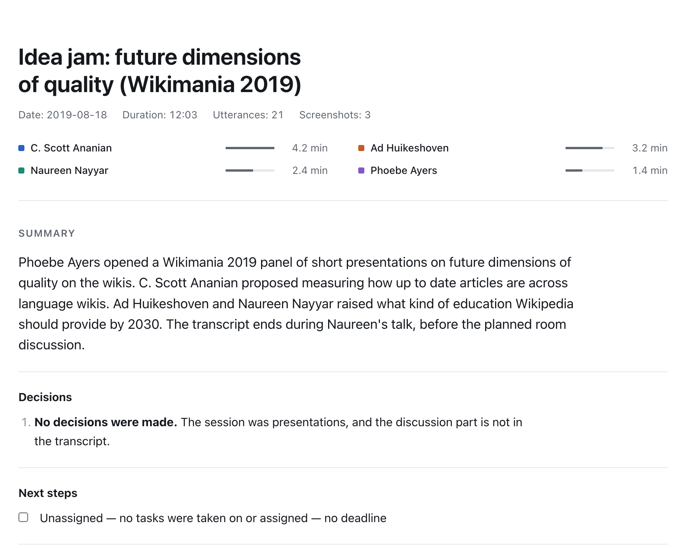
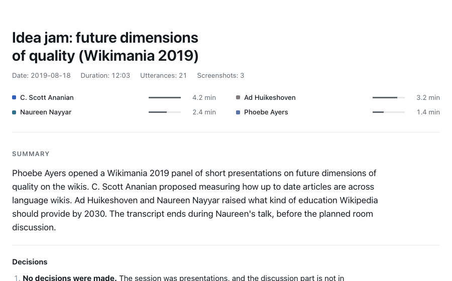
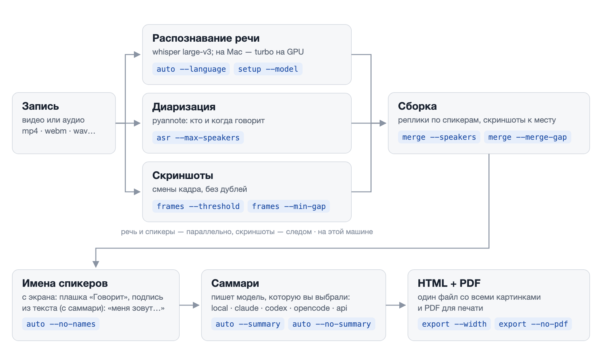

[English](README.md) | **Русский**

# meeting-transcribe

Транскрипт записи встречи по спикерам со скриншотами экрана. Распознавание и разделение по спикерам идут на этой
машине: запись никуда не уходит. Саммари пишет локальная модель или большая LLM на выбор: Claude, Codex,
любая модель из OpenCode или через API. Результат — `transcript.md`, текст с таймкодами, один HTML со вшитыми картинками,
который удобно кинуть в чат, и PDF.

## Установка

```bash
git clone https://github.com/Begemot34/meeting-transcribe.git && cd meeting-transcribe && ./transcribe setup
```

Или попроси агента (Claude Code, Codex, OpenCode, Gemini CLI, Cursor):

```text
Установи meeting-transcribe по https://github.com/Begemot34/meeting-transcribe/blob/main/INSTALL.md — только шаги оттуда.
```

[INSTALL.md](INSTALL.md) — короткая инструкция для агента: что проверить, что спросить у тебя (языки и чем
делать саммари) и какой командой ставить. Перед тем как вставлять, её можно прочитать самому.

## Запуск

```bash
./transcribe auto meeting.mp4 out/grooming --summary local
```

Результат — в `out/grooming`: `grooming.html` (один файл со всеми картинками), `grooming.pdf` и `transcript.md`.
`local` — модель, которая пишет саммари, на этой машине. Также можно `claude`, `codex`, `opencode`, `api`.

Поправить или дописать имена можно руками: запиши их в `names.json` (найденное `auto` лежит в
`out/grooming/.work/names.json`) — `{"SPEAKER_00": "Аня", "SPEAKER_01": "Олег"}`, пересобери транскрипт и заново
сделай саммари, уже с именами:

```bash
./transcribe merge out/grooming/.work out/grooming --speakers names.json --title grooming --date 2026-11-03
./transcribe summarize out/grooming --llm local    # или export, если саммари не нужно
```

Агент делает больше: он сам смотрит кадры, поэтому называет и того, кто показывает экран, и тех, кто есть только
в тексте, отбирает скриншоты и правит спорные реплики. Один раз:

```bash
./transcribe install-skill    # кладёт SKILL.md в ~/.claude/skills, ~/.agents/skills и ~/.cline/skills
```

Дальше в Claude Code, Codex, OpenCode, Gemini CLI, Cursor или Cline: «сделай транскрипт ~/Downloads/meeting.mp4
с саммари». Агент пройдёт шаги из [SKILL.md](SKILL.md): посмотрит кадры, прочитает имена с бейджа «Говорит: …»,
с плиток видео или из того, как люди представляются, и подпишет реплики именами вместо `SPEAKER_00`. Позвать
скилл явно: `/meeting-transcribe` в Claude Code, `$meeting-transcribe` в Codex.

<picture>
  <source media="(prefers-color-scheme: dark)" srcset="docs/report-dark.png">
  
</picture>

<details>
<summary>Прокрутка всего отчёта: саммари, обсуждение по темам, реплики со скриншотами (GIF, 3 MB)</summary>

<picture>
  <source media="(prefers-color-scheme: dark)" srcset="docs/report-scroll-dark.gif">
  
</picture>

</details>

Пример: 12 минут панели «Idea jam: future dimensions of quality» с Wikimania 2019, видео — [Wikimedia Sverige](https://commons.wikimedia.org/wiki/File:Idea_jam-_future_dimensions_of_quality.webm), [CC BY 3.0](https://creativecommons.org/licenses/by/3.0/).
Транскрипт, имена спикеров и саммари сделаны этим инструментом с агентом, без ручных правок текста, кроме
имён в самопредставлениях.

### Саммари

```bash
./transcribe summarize out/grooming --llm local   # или claude, codex, opencode, api; пересоберёт HTML и PDF
```

Правила саммари — в [scripts/summary_prompt.md](scripts/summary_prompt.md): решения с авторами, шаги
«кто — что — срок», риски, обсуждение по темам с таймкодами.

- `local` — `gemma4:26b` в [Ollama](https://ollama.com) на этой машине, ничего никуда не уходит. Скачивается
  18.7 GB, нужно 32 GB оперативки; если выбрать в `setup`, он поставит Ollama через brew и скачает модель;
- `claude` — твой [Claude Code](https://claude.com/claude-code);
- `codex` — твой [Codex CLI](https://github.com/openai/codex);
- `opencode` — модель из твоего [OpenCode](https://opencode.ai): `setup` покажет провайдеров и их модели и
  проверит выбранную тестовым запросом;
- `api` — любой сервер с OpenAI-совместимым Chat Completions API: OpenAI, OpenRouter, корпоративный шлюз,
  LM Studio, vLLM. Если выбрать его в `setup`, он спросит адрес сервера и ключ (ввод не отображается),
  подключится, даст выбрать модель из списка сервера и отправит ей проверочный запрос; если что-то не так —
  покажет ошибку и вернёт к выбору саммари. Адрес, модель и ключ сохраняются в `config.env` (читать его можешь
  только ты, в git он не попадает).

С `claude`, `codex`, `opencode` и удалённым `api` текст встречи уходит в этот сервис, с `local` — остаётся на
машине. Саммари делается из `transcript.md`, поэтому ручные правки имён и терминов в нём попадут в саммари.

### Языки

Распознавание `large-v3` многоязычное, одна модель на все языки. Для таймкодов по словам у каждого языка своя
модель выравнивания. У whisperx есть готовые для ~40 языков: английский и русский, а также ar, ca, cs, da, de,
el, es, eu, fa, fi, fr, gl, he, hi, hr, hu, id, it, ja, ka, ko, lv, ml, nl, nn, no, pl, pt, ro, sk, sl, sv, te,
tl, tr, uk, ur, vi, zh. `./transcribe setup --language ru,en` скачает модели для обоих, первый язык станет
языком по умолчанию. Другой язык для одной записи: `auto … --language en`.

Саммари пишется на языке встречи. Заголовки в `transcript.md`, HTML и PDF — русские или английские: у остальных
языков английские.

Для другого языка или своей модели выравнивания: `MT_ALIGN_MODEL=<репозиторий wav2vec2 на huggingface.co>`
или путь к папке с такой моделью. Своя модель распознавания: `MT_WHISPER_MODEL=<имя, репозиторий или папка>`
в формате CTranslate2.

## Настройки

| Переменная | По умолчанию | Что делает |
| --- | --- | --- |
| `MT_DEVICE` | из `setup` (`cpu`) | `cuda` — распознавание и диаризация на NVIDIA GPU (Linux); `setup` предложит сам, если найдёт карту |
| `MT_COMPUTE_TYPE` | `int8` на CPU, `float16` на GPU | точность распознавания; для GPU меньше 8 GB берётся `int8_float16` |
| `MT_DIARIZE_DEVICE` | GPU Mac (MPS), если есть, иначе `MT_DEVICE` | где считать диаризацию; `cpu` — принудительно на CPU |
| `MT_LANGUAGE` | `en` | язык встреч по умолчанию |
| `MT_WHISPER_MODEL` | `mlx-large-v3-turbo` на Apple Silicon, иначе `large-v3` | `large-v3` — whisperx на CPU, самая точная; `large-v3-turbo`, `medium`, `small` — быстрее, хуже; репозиторий CTranslate2 или папка |
| `MT_ALIGN_MODEL` | по языку | своя модель выравнивания: репозиторий wav2vec2, папка или имя модели torchaudio |
| `MT_LLM` | из `setup` | чем `auto` делает саммари: `claude`, `codex`, `opencode`, `local`, `api`; пусто — без саммари |
| `MT_LOCAL_MODEL` | `gemma4:26b` | модель Ollama для `--llm local` |
| `MT_OPENCODE_MODEL` | из `setup` | `провайдер/модель` для `--llm opencode` |
| `MT_LLM_TIMEOUT` | `1800` | сколько секунд ждать саммари |
| `MT_LLM_TEMPERATURE` | — | temperature для `--llm api` (по умолчанию не передаётся: reasoning-модели её не принимают) |
| `MT_LLM_BASE_URL` | `https://api.openai.com/v1` | адрес OpenAI-совместимого API для `--llm api` |
| `MT_LLM_API_KEY` | `OPENAI_API_KEY` | ключ для `--llm api` (для локальной Ollama не нужен) |
| `MT_LLM_MODEL` | — | модель для `--llm api` |
| `HF_HOME` | `~/.cache/huggingface` | куда класть модели |
| `HF_ENDPOINT` | `https://huggingface.co` | зеркало Hugging Face |
| `HTTPS_PROXY` | — | прокси для скачивания моделей |
| `MT_DOWNLOAD_STALL_S` | `120` | через сколько секунд без прогресса перезапускать загрузку |
| `MT_DOWNLOAD_ATTEMPTS` | `5` | сколько раз пробовать скачать модель |
| `PYANNOTE_METRICS_ENABLED` | `false` | метрики использования pyannote.audio в pyannote.ai; выключены, чтобы ничего не уходило с машины |

Настройки `setup` — в `config.env`.

| Команда и флаг | По умолчанию | Что делает |
| --- | --- | --- |
| `auto --title T --date D` | имя файла, сегодня | заголовок и дата в транскрипте |
| `auto` / `asr` / `doctor --language X` | `MT_LANGUAGE` | язык встречи |
| `setup --language ru,en --model M --device cpu\|cuda --summary S --skill\|--no-skill --yes` | спросит | настройка без вопросов |
| `auto --summary claude\|codex\|opencode\|local\|api` / `--no-summary` | из `setup` | саммари для этого запуска |
| `auto --no-names` | имена ищутся | оставить `SPEAKER_xx`: не искать имена на экране и в тексте |
| `asr --max-speakers N` | `10` | верхняя граница числа спикеров |
| `frames --threshold X` | `0.3` | чувствительность к смене кадра; `0.08` — если экран листали |
| `frames --min-gap S` | `15` | минимум секунд между скриншотами |
| `badges --crop W:H:X:Y` | `360:76:1240:0` | где на кадре бейдж «Говорит: …» |
| `badges --share-start S` | `70` | с какой секунды идёт шаринг экрана |
| `badges --per-speaker N` | `6` | сколько кропов бейджа на спикера |
| `badges --probe T` | — | сохранить полный кадр на секунде T, чтобы подобрать `--crop` |
| `strip --duration S` | `40` | длина посекундной ленты бейджа |
| `merge --speakers file.json` | — | имена спикеров `{"SPEAKER_00": "Имя"}` |
| `merge --language X` | распознанный язык | язык заголовков результата |
| `merge --merge-gap S` | `1.5` | склеивать реплики одного спикера с паузой меньше S секунд |
| `merge --raw-speakers` | — | оставить метки диаризации как есть: без сглаживания и поправки границ |
| `summarize --model M` | модель CLI по умолчанию; для `opencode` — `MT_OPENCODE_MODEL` | модель для саммари |
| `export --no-pdf` | — | только HTML; `export` пересобирает HTML и PDF после ручных правок `transcript.md` |
| `export --width W --quality Q` | `1280`, `72` | размер и качество JPEG скриншотов в HTML |

Скорость на M4 Pro: с `mlx-large-v3-turbo` (по умолчанию на Apple Silicon) ≈ 0,1 от длины записи, час встречи —
около 6 минут; с `large-v3` (whisperx на CPU) ≈ 0,4, час — около 25 минут. Диаризация в обоих случаях на GPU Mac.
Качество близкое: на русской и английской встречах текст mlx расходится с whisperx в 12% и 5% слов, в основном
слова-паразиты и формы слов; слепой судья поставил whisperx 7,5/10, mlx turbo 7,0. Если точность важнее
времени — выберите `large-v3` в `./transcribe setup`. На NVIDIA GPU whisperx large-v3 в разы быстрее, чем на
CPU (сами не замеряли: нет такой машины).

## Как устроено

<picture>
  <source media="(prefers-color-scheme: dark)" srcset="docs/pipeline-ru-dark.png">
  
</picture>

На каждом шаге — флаги, которые его меняют; значения по умолчанию задаёт `setup`, полный список — в [Настройках](#настройки).

- распознавание: на Mac с Apple Silicon — [mlx-whisper](https://github.com/ml-explore/mlx-examples/tree/main/whisper)
  (whisper large-v3-turbo на GPU), на остальных — [whisperx](https://github.com/m-bain/whisperX) (faster-whisper
  large-v3 + выравнивание по словам) на CPU или NVIDIA GPU;
- спикеры: [pyannote](https://github.com/pyannote/pyannote-audio) `speaker-diarization-community-1`;
- скриншоты: смены сцены ffmpeg + отсев дублей;
- имена на экране: Apple Vision на macOS, [EasyOCR](https://github.com/JaidedAI/EasyOCR) на Linux, на этой машине.

## Ограничения

- Подходит для любой записи, которую читает ffmpeg: Zoom, Meet, Teams, диктофон; mp4, mkv, webm, m4a, wav.
  От клиента видеосвязи зависит только чтение имён: `auto` ищет имя, которое видно на экране, пока говорит один
  спикер, и не видно, пока говорят другие, — где бы оно ни было на кадре. У того, кто показывает экран, плашки
  обычно нет: его `auto` называет только по тексту. Если клиент не показывает, кто говорит, имена берутся из
  обращений в тексте, иначе остаётся `SPEAKER_xx`.
- Короткие реплики (1–3 слова) диаризация иногда отдаёт не тому спикеру.
- Несколько человек у одного микрофона в переговорке разделяются хуже, чем каждый со своим микрофоном.
- В одной папке результата — одна запись: `auto` не даст подмешать в неё другую.
- Нужны macOS 14+ на Apple Silicon или Linux x86_64/aarch64 с glibc 2.28+ (Ubuntu 20.04+); Mac на Intel не
  поддерживается: PyTorch больше не выпускает для него сборки. NVIDIA GPU — только Linux x86_64, драйвер 570+.
- `install-skill` записывает в скилл путь к этой папке: после переноса папки запусти его снова (`doctor`
  покажет устаревшую копию); `uninstall-skill` удаляет её.

## Лицензии

Код этого репозитория — [MIT](LICENSE), кроме каталога `models/`. Компоненты, которые стоят в таблице с
лицензией, разрешают коммерческое использование.

| Компонент | Как попадает к пользователю | Лицензия |
| --- | --- | --- |
| код `transcribe`, `scripts/` | этот репозиторий | MIT |
| картинки примера в `docs/` | этот репозиторий; кадры и текст из [видео Wikimedia Sverige](https://commons.wikimedia.org/wiki/File:Idea_jam-_future_dimensions_of_quality.webm) | CC BY 3.0 |
| [pyannote speaker-diarization-community-1](https://huggingface.co/pyannote/speaker-diarization-community-1) | копия в `models/`, без изменений, см. [NOTICE](models/speaker-diarization-community-1/NOTICE.md) | CC BY 4.0 |
| [Whisper large-v3](https://huggingface.co/openai/whisper-large-v3) (OpenAI) в конвертации [Systran/faster-whisper-large-v3](https://huggingface.co/Systran/faster-whisper-large-v3) | скачивается с Hugging Face при первом запуске | Apache-2.0 (веса OpenAI), MIT (конвертация) |
| [wav2vec2-large-xlsr-53-russian](https://huggingface.co/jonatasgrosman/wav2vec2-large-xlsr-53-russian) (выравнивание по словам для русского) | скачивается с Hugging Face при первом запуске | Apache-2.0 |
| [Gemma 4](https://huggingface.co/google/gemma-4-26b-a4b-it) `gemma4:26b` (только с `--llm local`) | скачивает Ollama в `setup`, если выбрать | Apache-2.0 (по вторичным источникам, с лицензией Google не сверено) |
| Ollama (только с `--llm local`) | ставит `setup` через brew, если выбрать | MIT |
| словарь nltk `punkt_tab` | скачивается с GitHub nltk_data при первом запуске | не проверено |
| модели выравнивания torchaudio для en/fr/de/es/it | скачиваются с download.pytorch.org, только для этих языков | не проверено |
| whisperx | PyPI | BSD-2-Clause |
| pyannote.audio | PyPI | MIT |
| mlx-whisper, mlx (только Apple Silicon) | PyPI | MIT |
| [whisper-large-v3-turbo](https://huggingface.co/mlx-community/whisper-large-v3-turbo) в формате MLX (только Apple Silicon) | скачивается с Hugging Face при первом запуске | MIT (веса OpenAI); у конвертации лицензия не указана |
| faster-whisper, CTranslate2 | PyPI | MIT |
| PyTorch, torchaudio | PyPI | BSD-3-Clause |
| transformers, huggingface-hub | PyPI | Apache-2.0 |
| Pillow | PyPI | MIT-CMU |
| pyobjc-framework-Vision (только macOS: системный OCR для имён на экране) | PyPI | MIT |
| EasyOCR (только Linux: имена на экране) и его модели детектора и кириллицы/латиницы | PyPI; модели — из релизов EasyOCR на GitHub в `setup` | Apache-2.0 |
| OpenCV (opencv-python-headless), scikit-image (только Linux, для EasyOCR) | PyPI | Apache-2.0, BSD-3-Clause |
| fpdf2 (PDF) | PyPI | LGPL-3.0 |
| шрифт DejaVu Sans (PDF) | внутри matplotlib, зависимости pyannote | Bitstream Vera / public domain |
| imageio-ffmpeg | PyPI, внутри — сборка FFmpeg | BSD-2-Clause; бинарь FFmpeg собран с `--enable-gpl` (GPL) |

Python-пакеты и FFmpeg этот репозиторий не распространяет: `uv` ставит их из PyPI на машину пользователя по
`uv.lock`. fpdf2 используется как библиотека без изменений — LGPL это разрешает. FFmpeg вызывается как
отдельная программа, поэтому GPL сборки на код репозитория не распространяется. Если в системе уже есть
`ffmpeg`, используется он.
